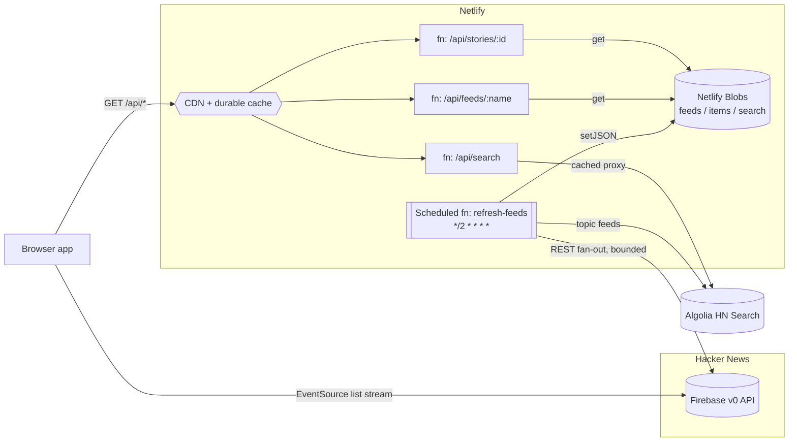
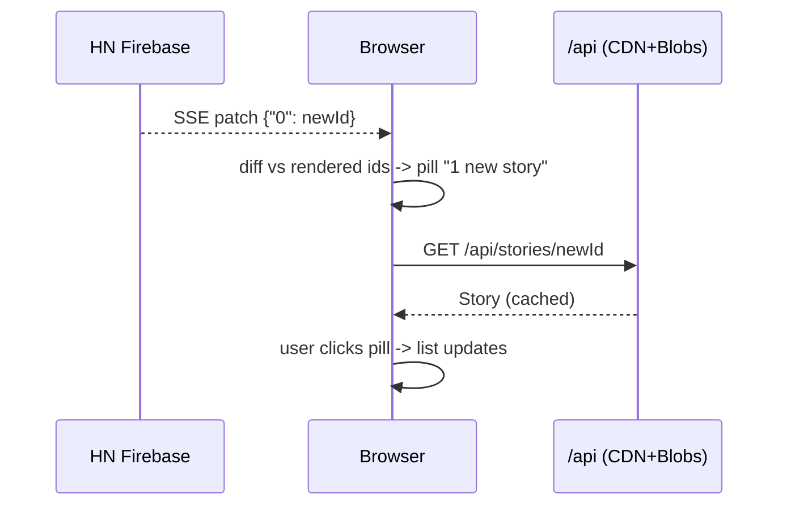

# Architecture & Technical Decision Records

## Purpose
Make every significant decision explicit, reviewable and reversible-with-context. Baseline architecture: [08-app-architecture](../../../docs/08-app-architecture.md), adapted to Netlify per [expert-roster](../../../docs/expert-roster.md#deployment-context-that-shapes-the-roster).

## When to use
- A choice affects more than one module/agent, is costly to reverse, or resolves an open decision from [09](../../../docs/09-agent-team-briefing.md#open-decisions-for-dr-lee--architect).
- Not for local implementation details (variable names, small refactors).

## Where and how
- Files: `docs/adr/NNNN-kebab-title.md`, numbered sequentially, never renumbered.
- Status lifecycle: `Proposed` -> `Accepted` -> (`Superseded by ADR-NNNN` | `Deprecated`). Never edit an accepted ADR's decision; write a new one that supersedes it.
- Each ADR lands via PR; architect + one affected agent review.
- Keep `docs/adr/README.md` as an index table (number, title, status, date).

## Template
```markdown
# ADR-NNNN: <Decision title>
- Status: Proposed | Accepted | Superseded by ADR-XXXX
- Date: YYYY-MM-DD
- Deciders: solution-architect, <others>
- Related: docs/08, US-xx, ADR-yyyy

## Context
<Forces: requirements, constraints (Netlify short-lived functions, HN N+1, Algolia 10k/hr/IP), facts with links.>

## Options
| Option | Pros | Cons | Cost/effort |
|---|---|---|---|

## Decision
<One clear sentence: "We will ...">

## Consequences
- Positive: ...
- Negative / risks: ... (and mitigation)
- Follow-ups: issues/stories created

## Validation
<How we'll know it was right: metric, test, spike result. When to revisit.>
```

## Seed ADR backlog
| ADR | Decision | Recommended default (from research) |
|---|---|---|
| 0001 | Record architecture decisions | Use ADRs in `docs/adr/` |
| 0002 | Ingestion model on Netlify | **Scheduled Function cron polling (1-5 min) into Blobs**; no always-on SSE worker (Functions are short-lived) |
| 0003 | Live updates to clients | **Browser `EventSource` direct to Firebase** list endpoints; polling `/api/feeds` fallback |
| 0004 | Frontend framework & render mode | Next.js (default) vs Vite SPA vs SvelteKit; SSR/ISR 30-60 s or SPA + CDN API |
| 0005 | Storage | **Netlify Blobs** for feeds/items (MVP); Postgres/Supabase only when history/digests arrive (V2) |
| 0006 | Search | **Algolia via cached Netlify Function**; no browser-direct calls |
| 0007 | HTML safety | Sanitize at ingest **and** render with DOMPurify allow-list; decode titles to text |
| 0008 | Jobs in Top feed | Label as "Job" (vs filter) |
| 0009 | Testing policy | Fixtures by default, opt-in live smoke; MSW `onUnhandledRequest: error` |
| 0010 | Platform scope | Web/PWA only for MVP (open decision #1) |

## Reference architecture (Netlify-native)


Sequence for "new story appears":


## Key trade-offs to cite
| Topic | Trade-off |
|---|---|
| Backend vs client-only | Backend: 1 request/page for users, normalize once, history possible. Client-only: zero infra but N+1 first paint (valid prototype) |
| SSE worker vs cron | SSE: seconds-fresh, needs long-lived process (not Netlify Functions). Cron: 1-5 min fresh, serverless; browser SSE covers live gap |
| Blobs vs Postgres | Blobs: zero setup, key-value, eventual consistency. Postgres: queries, snapshots, velocity, digests; extra service + cost |
| Firebase vs Algolia | Firebase = ranking + freshness truth. Algolia = search, history, one-call trees; lags, 10k/hr/IP |

## Review checklist for an ADR
- [ ] Context cites facts (docs links, measurements), not opinions.
- [ ] At least two real options with honest cons.
- [ ] Decision is one unambiguous sentence.
- [ ] Consequences include risks + mitigation and follow-up stories.
- [ ] Revisit trigger stated (e.g. "if refresh-feeds p95 > 20 s" or "when digests are scheduled").
- [ ] Diagrams updated if data flow changed.

## Pitfalls
- Deciding in chat/PR comments only; the next agent can't find it.
- Rewriting history instead of superseding.
- Architecture that silently assumes a long-lived process on Netlify.
- Diagrams as images that can't be diffed - use Mermaid in Markdown.

## Used by
product-owner, solution-architect, data-engineer, performance-realtime-engineer, security-engineer, expert-orchestrator
